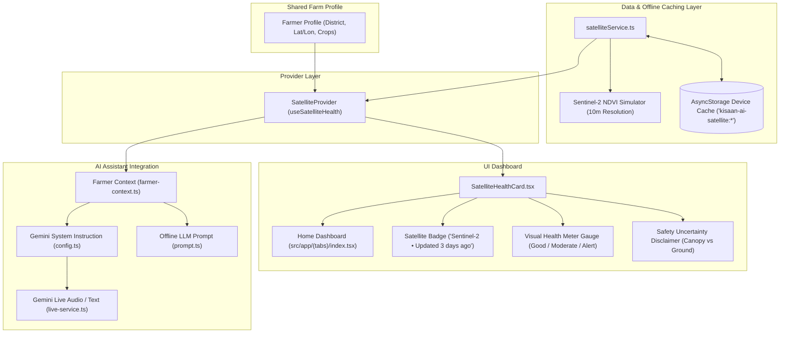

# Implementation Plan: Field Satellite Health Monitoring (NDVI / Crop Vigor)

This plan outlines the design and implementation for adding **Field Satellite Health Monitoring (NDVI / Crop Vigor)** to Kisaan AI. It incorporates Sentinel-2 satellite simulation, offline-first caching via AsyncStorage, bilingual Urdu/English typography matching the design language in [`52744908-e24a-410f-9feb-43284e05b641.pdf`](file:///e:/KisaanAI/kisaan-ai-mobile-app/docs/52744908-e24a-410f-9feb-43284e05b641.pdf), safety-first uncertainty framing, and live context integration into the Gemini AI companion and offline assistant.

---

## 1. Feature Architecture

---

## 2. Core Modules & Responsibilities

### Module A: Data Service (`src/services/satelliteService.ts` & `services/satelliteService.ts`)
- **Location-Aware Simulation**:
  - Ingests the farmer's district and coordinates (`latitude`, `longitude`).
  - Simulates Sentinel-2 L2A satellite metrics for the farmer's crop canopy:
    - **NDVI Score**: 0.00 to 1.00 (e.g., 0.72 - Good, 0.52 - Moderate, 0.35 - Alert).
    - **Health Status**: `'good'` (Green: NDVI $\ge 0.60$), `'moderate'` (Yellow: $0.40 \le \text{NDVI} < 0.60$), `'alert'` (Red: $\text{NDVI} < 0.40$).
    - **Vegetation Density**: e.g., 78% (percentage of ground covered by active green canopy).
    - **Moisture Index / Level**: e.g., 64% (`'adequate'`, `'low'`, `'surplus'`) proxying NDWI.
    - **Cloud Coverage**: e.g., 4% (Sentinel-2 cloud mask check).
    - **Satellite Details**: Sentinel-2 constellation, 10m spatial resolution, 5-day revisit cycle.
    - **Timestamps**: Acquisition date 3 days ago (`Date.now() - 3 * 86400000`) matching `"Sentinel-2 • Updated 3 days ago"`.
- **Graceful Offline Caching**:
  - Cache key patterned as `kisaan-ai-satellite:${districtId || lat_lon}`.
  - Stored in `AsyncStorage`.
  - When offline or when fetching fails, immediate retrieval of the cached snapshot.
  - Snapshot tagged with source: `'network'`, `'cache'`, or `'simulated'`.

### Module B: Context Provider (`src/providers/satellite-provider.tsx`)
- Provides `useSatelliteHealth()` React hook.
- Manages reactive state: `snapshot`, `status` (`'idle' | 'loading' | 'ready' | 'error'`), `isRefreshing`, and `refresh()`.
- Hooks into `useProfile()` and `useNetwork()` to automatically load and refresh satellite telemetry when profile coordinates change.
- Injected into root tree inside [`src/app/_layout.tsx`](file:///e:/KisaanAI/kisaan-ai-mobile-app/src/app/_layout.tsx).

### Module C: UI Card Component (`src/components/satellite/satellite-health-card.tsx` & `src/components/SatelliteHealthCard.tsx`)
- Placed on Home Dashboard ([`src/app/(tabs)/index.tsx`](file:///e:/KisaanAI/kisaan-ai-mobile-app/src/app/(tabs)/index.tsx)).
- **Visual Design & Design Language**:
  - Adheres strictly to [`src/constants/theme.ts`](file:///e:/KisaanAI/kisaan-ai-mobile-app/src/constants/theme.ts) colors (`colors.card`, `colors.border`, `colors.primaryDark`, `colors.success`, `colors.warning`, `colors.red`).
  - Card rounded border (`borderRadius: 22`, `borderWidth: 1`), consistent with `WeatherCard`.
- **Components of the Card**:
  1. **Satellite Status Header**:
     - Satellite badge: `🛰️ Sentinel-2 • Updated 3 days ago` (localized in Urdu: `🛰️ سینٹینل-2 • 3 دن پہلے اپ ڈیٹ ہوا`).
     - Freshness or Cache badge indicator.
  2. **Visual Health Meter Gauge**:
     - Visual 3-segment color-coded bar/gauge with continuous indicator needle/marker:
       - 🟢 **Good / صحت مند** ($\text{NDVI} \ge 0.60$)
       - 🟡 **Moderate / درمیانہ** ($0.40 \le \text{NDVI} < 0.60$)
       - 🔴 **Alert / توجہ طلب** ($\text{NDVI} < 0.40$)
     - Numeric readout showing exact NDVI value (e.g. `0.74`) and qualitative title.
  3. **Sub-metrics Grid**:
     - Vegetation Density (e.g. `78%`)
     - Moisture Level (e.g. `62% · Adequate`)
     - Resolution & Satellite (e.g. `10m · Sentinel-2`)
  4. **Uncertainty & Safety Framing Box**:
     - As required by the safety rules in the product case study (Page 12: *"Trust comes from clear boundaries"*):
     - English: *"Satellite NDVI measures canopy reflectance from orbit, not root health or subterranean pests. Cloud shadows, soil moisture, or weeds can influence scores. Always inspect field conditions on foot before spraying or taking irreversible action."*
     - Urdu: *"سیٹلائٹ ریڈنگ خلا سے پودوں کی ہریالی کا تخمینہ ہے، یہ جڑوں یا کیڑوں کی حتمی تصدیق نہیں ہے۔ کوئی بھی سپرے یا بڑا فیصلہ کرنے سے پہلے کھیت کا خود معائنہ ضرور کریں۔"*
  5. **Dual-Language & Typography Support**:
     - Fully bilingual in English and Nastaliq Urdu via `AppText`.
     - Respects RTL layout direction, text alignment, and Android Nastaliq line heights.

### Module D: Live AI Assistant Integration
- **Context Injection**:
  - Update [`src/services/gemini/farmer-context.ts`](file:///e:/KisaanAI/kisaan-ai-mobile-app/src/services/gemini/farmer-context.ts) to format the latest satellite NDVI telemetry into the context prompt.
  - Update [`src/services/gemini/config.ts`](file:///e:/KisaanAI/kisaan-ai-mobile-app/src/services/gemini/config.ts) with specialized system instructions on how Gemini Live interprets NDVI scores:
    - How to interpret high/moderate/low crop vigor for wheat, potato, tomato.
    - Safety guardrails: Never recommend expensive/toxic chemical sprays based purely on an orbital NDVI dip without advising physical field scouting.
  - Update [`src/services/gemini/live-service.ts`](file:///e:/KisaanAI/kisaan-ai-mobile-app/src/services/gemini/live-service.ts) and [`src/hooks/use-gemini-live-chat.ts`](file:///e:/KisaanAI/kisaan-ai-mobile-app/src/hooks/use-gemini-live-chat.ts) to accept and bind satellite telemetry into the active multimodal session.
  - Update [`src/services/offline-llm/prompt.ts`](file:///e:/KisaanAI/kisaan-ai-mobile-app/src/services/offline-llm/prompt.ts) so the offline Qwen model also has satellite context when operating without signal.

---

## 3. Files to Create and Modify

| Path | Action | Description |
|---|---|---|
| `src/locales/en.json` | Edit | Add English strings for satellite status, gauge, metrics, and safety disclaimers |
| `src/locales/ur.json` | Edit | Add Urdu strings matching the English keys |
| `src/services/satelliteService.ts` | Create | Core Sentinel-2 NDVI calculation, mock provider, and AsyncStorage caching |
| `services/satelliteService.ts` | Create | Re-export file to fulfill root-level path contract |
| `src/providers/satellite-provider.tsx` | Create | React Context provider and `useSatelliteHealth` hook |
| `src/app/_layout.tsx` | Edit | Register `SatelliteProvider` in root layout |
| `src/components/satellite/satellite-health-card.tsx` | Create | Visual satellite health card with meter gauge and uncertainty framing |
| `src/components/SatelliteHealthCard.tsx` | Create | Re-export component for direct import convenience |
| `src/app/(tabs)/index.tsx` | Edit | Render `SatelliteHealthCard` on the Home screen |
| `src/services/gemini/farmer-context.ts` | Edit | Include satellite NDVI metrics in farmer context string |
| `src/services/gemini/config.ts` | Edit | Add AI guidance rules for satellite NDVI reasoning and uncertainty boundaries |
| `src/services/gemini/live-service.ts` | Edit | Support satellite telemetry injection in live session |
| `src/hooks/use-gemini-live-chat.ts` | Edit | Pass satellite data from provider into `GeminiLiveService` |
| `src/services/offline-llm/prompt.ts` | Edit | Include satellite context in offline LLM prompt |

---

## 4. Verification and Safety Validation
1. **Type Checking**: Run `npx tsc --noEmit` to ensure 100% clean TypeScript typing.
2. **Offline Resilience**: Verify that when network is disconnected, cached satellite metrics render with clear cache indicators.
3. **Bilingual Typography**: Ensure both English and Urdu render correctly with `AppText` without clipped descenders.
4. **Safety Verification**: Ensure the uncertainty disclaimer is prominent and that the AI assistant prompt explicitly commands the model not to prescribe sprays without field scouting.
